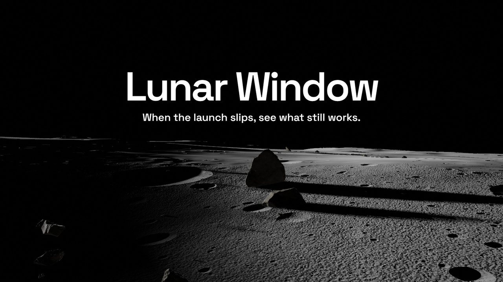
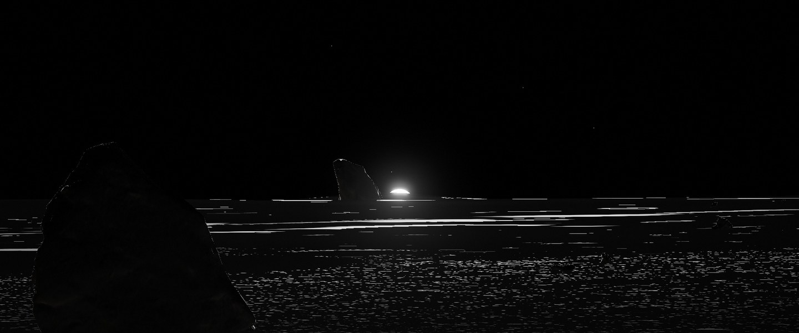
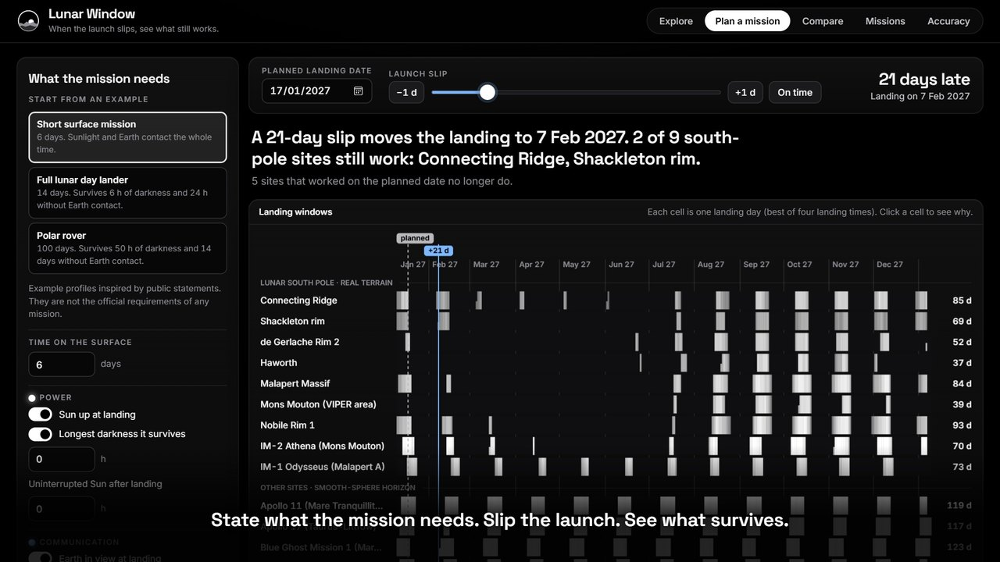

# Lunar Window

**When the launch slips, see what still works.** A landing-window planner for the lunar south pole.

Built for the NASA Space Apps Challenge 2026, challenge *Lunar Landing Site Navigator*.

**Open it: https://machinedramon.github.io/lunar-window/**



| | |
|---|---|
|  |  |
| *One ridge decides: the Sun through a long lens, with the share of the disc that clears the terrain.* | *Plan a mission: every site and landing day of a year, what a slip does to them, and the sites on a map of the south pole.* |

Most tools ask you to pick a landing site and a date, then show you the sky. Lunar Window starts from
what a mission needs — sunlight at landing, hours of continuous power, Earth in view for
communication — and shows every site and day that works across a year. When the launch date moves,
it shows which sites survive, which fail, and why.

## What is in it

- **Explore** — pick a site and a moment; stand there in 3D, or read the 360° panorama and the 30-day timeline. Seven real landings can be replayed, and any latitude and longitude can be entered (without terrain: a smooth Moon).
- **Plan a mission** — requirements in, landing windows out, for 15 sites over a year; slip the launch and see what survives, and why. A map of the south pole shows the sites on NASA's relief, with the permanently shadowed ground in black.
- **Compare** — up to four options side by side.
- **Missions** — three planning problems to play, scored on real quantities.
- **Accuracy** — the measured errors against NASA data, and the limits of the model.

Built during the hackathon weekend (14–15 November 2026).

## How it works

- **Terrain horizon.** For each site, an offline Python tool reads NASA LOLA elevation models
  and computes the elevation of the terrain horizon in 1440 directions, for observers 0, 2 and 10 m
  above the ground.
- **Sun and Earth.** The browser computes where the Sun and the Earth are, as seen from the site,
  with [astronomy-engine](https://github.com/cosinekitty/astronomy). No server is involved.
- **Planner.** Mission requirements are checked against the horizon for every landing day.
- **Stand there.** A first-person 3D view from the site: the real LOLA terrain (5 m near seven of the
  sites) with shadows marched through the elevation data, and the Sun and the Earth at their true
  positions, sizes, phase and rotation.

Accuracy is measured against NASA products (JPL Horizons and the LOLA average-illumination maps) and
published with the tool, including where it does not hold.

## Run it

```bash
npm install
npm run dev      # http://localhost:5700
npm test
npm run build
```

Rebuilding the horizon profiles needs Python 3.12 with numpy and the NASA source rasters; see
[`tools/README.md`](tools/README.md).

## Data and references

All external data, code and reading are listed in [`docs/REFERENCES.md`](docs/REFERENCES.md).

## Use of AI

An AI coding assistant (a large language model) was used throughout this project: to research NASA
data sources, the rules and prior work; to propose and compare design options; and to generate most of
the code, the tests and the documentation. The team member chose the challenge, chose among the options
proposed and set the direction, reviewed the work on screen at every step and decided what to keep.

All numerical results were validated against NASA data (JPL Horizons tables and LOLA illumination maps);
the measured errors are published on the Accuracy page of the tool.

In the tool itself nothing is an AI-generated image, video or sound: the visuals are rendered in real
time from NASA data and open-licensed 3D assets, and the sounds are synthesised by code. The 30-second
demo video is a recording of the tool; its narration is an AI-generated voice (OpenAI text-to-speech)
reading a script, as its closing credits and file metadata state, and its music is synthesised by code
(`tools/film_audio.py`).

## License

[MIT](LICENSE). NASA data is in the public domain; this project is not endorsed by NASA.
